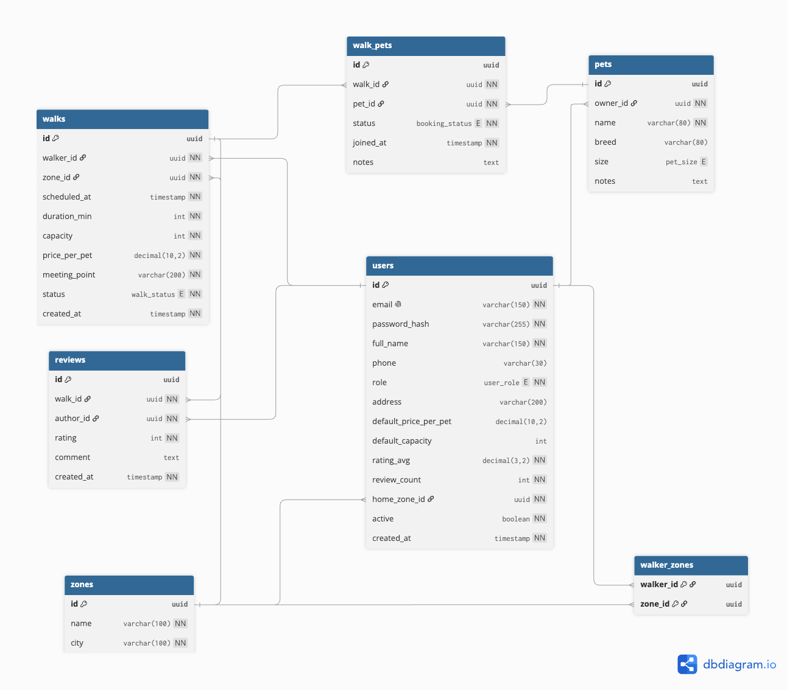

# TP 🐾

A web application that connects pet owners with dog walkers in the City of Buenos Aires (CABA). Walkers publish group walks — schedule, zone, meeting point, capacity, and price per pet — and owners join with their pets while there's room, replacing informal WhatsApp/social-media coordination with a centralized, reliable platform.

**Capstone Project (Trabajo Final Integrador) — Tecnicatura Universitaria en Programación a Distancia (TUPaD), UTN**

## Team

- Gastón Lell
- Juan Cruz Leal
- Gabriel Lovera

## Table of Contents

- [Purpose](#purpose)
- [MVP Scope](#mvp-scope)
- [Tech Stack](#tech-stack)
- [Architecture](#architecture)
- [Modules](#modules)
- [Data Model](#data-model)
- [Design Decisions](#design-decisions)
- [Installation and Setup](#installation-and-setup)
- [Repository Structure](#repository-structure)
- [Delivery Roadmap](#delivery-roadmap)

## Purpose

The City of Buenos Aires is undergoing a structural demographic shift: its pet population now far exceeds its child population (493,676 dogs and 368,176 cats compared to 460,696 children under 14, according to INDEC 2022). This has driven growing demand for dog walking services, yet coordination between owners and walkers is still handled informally today like WhatsApp, social media with no system to centralize availability, coverage area, and scheduling.

This project is looking for replacing that informal coordination with a centralized, reliable platform.

## MVP Scope

**In scope:**
- Registration and profiles for two roles: Owner (client) and Walker
- Walker profile publishing with coverage zones (predefined neighborhoods), a reference price per pet, and a default group capacity
- Coverage zone visualization on a map (Leaflet + OpenStreetMap)
- Search for published walks by zone
- Group walk publishing and booking: walkers publish a walk with schedule, meeting point, capacity, and price per pet; owners join their pets until the walk is full. There is no request/accept flow — owners join what's already published
- Rating and review system for completed walks
- Basic history of scheduled walks

**Out of scope:**
- Integrated online payments
- Real-time GPS tracking during the walk
- Native mobile app (the web app will be responsive)
- Recurring or declared walker availability schedules (a walk's own publication *is* the availability signal — see design decisions)
- Free-form zone drawing on the map (predefined neighborhoods are used instead of geospatial polygons)

## Tech Stack

| Layer | Technology |
|---|---|
| Frontend | TypeScript + React (Vite) + Tailwind CSS, pnpm |
| Backend | Java + Spring Boot |
| Database | PostgreSQL |
| Map | Leaflet + OpenStreetMap |
| Authentication | Spring Security + JWT |
| Frontend Deployment | Vercel / Netlify |
| Backend Deployment | Render / Railway |
| Database Deployment | Railway / Supabase |

## Architecture

A layered monolithic architecture (controller → service → repository) built with Spring Boot. A microservices architecture is out of the scope because the project's domain (owners, walkers, walks, zones) has no modules with independent lifecycles or teams that would justify that operational complexity; a layered monolith is achievable within the course timeline and avoids over-engineering.

## Modules

Full detail — features, responsibilities, dependencies and acceptance criteria per module — in [`docs/modulos.md`](docs/modulos.md).

| Module | Backend package | Frontend folder | Responsibility |
|---|---|---|---|
| Authentication | `auth` | `features/auth` | Registration, login, password hashing, JWT issuing and validation, role-based access |
| Users and profiles | `user` | `features/profile` | Own profile, home zone and contact data, logical deactivation |
| Walkers and coverage | `user` | `features/profile`, `features/map` | Walker service zones (`walker_zones`), default price and capacity, public walker profile |
| Pets | `pet` | `features/pets` | Create, list and edit the owner's own pets |
| Zones and map | `zone` | `features/map` | Neighborhood catalog and coverage map |
| Walks and schedule | `walk` | `features/walks` | Publish group walks, overlap check, cancel/complete, walk history per role |
| Bookings | `walk` | `features/walks` | Join a pet to a published walk, capacity control with pessimistic lock, cancel/re-join |
| Walk search | `walk` | `features/walks` | List published future walks by zone with remaining spots |
| Reviews | `review` | `features/reviews` | Rate completed walks, update walker rating average and count |
| Cross-cutting | `shared` | `shared` | Configuration, security, validation, error handling, HTTP client, UI components |

## Data Model



Seven tables: `zones`, `users`, `walker_zones`, `pets`, `walks`, `walk_pets`, `reviews`. The SQL scripts live in [`database/`](./database/): DDL ([`01_schema.sql`](database/01_schema.sql)), seed data ([`02_seed.sql`](database/02_seed.sql)) and integrity checks ([`03_verify.sql`](database/03_verify.sql)), with instructions in [`database/README.md`](database/README.md). The backend applies the same schema automatically through Flyway migrations in [`backend/src/main/resources/db/migration/`](./backend/src/main/resources/db/migration/). Data model details in [`docs/modelo-datos.md`](docs/modelo-datos.md).

## Design Decisions

### Single `USERS` table with a `role` field

A single `USERS` table with a `role` field was chosen over separate tables (`OWNERS` and `WALKERS`) from the start, because both roles share the same core identity data — name, email, password, national ID — and the system has only two fixed, mutually exclusive roles, with no need for a user to hold multiple roles at once or for new roles to be added dynamically.

This is a deliberate trade-off that avoids the complexity of a normalized roles table (`roles` plus a `user_roles` join table), which would only add value if the system required configurable or multiple roles per user, for this case outside the MVP's scope.

### Walker publishes, owner joins — no request/accept flow

A walk is an offer the walker publishes (schedule, zone, meeting point, capacity, price per pet); owners pick from what's published instead of requesting a slot and waiting for a response. That single decision removes the need for a separate availability/schedule table: the set of published, non-past walks *is* the walker's availability. The only rule protecting a walker's calendar is that two of their own active walks can't overlap in time.

### `walk_pets` is a business entity, not a join table

Each row is a client's booking of one pet into a published walk: it carries its own `id`, a `status` that changes over time (`JOINED` / `CANCELLED`), and `joined_at`. It is mapped as its own JPA entity rather than a `@ManyToMany`, since a plain join table can't carry that state — and it's the natural place to hang a future payment record, since each client pays for their own booking.

## Installation and Setup

> ⚠️ Section to be completed 

```bash
# Backend
cd backend
./mvnw spring-boot:run

# Frontend (requires Node.js and pnpm)
cd frontend
pnpm install
pnpm dev        # http://localhost:5173
```

Required environment variables (backend): `DB_URL`, `DB_USER`, `DB_PASSWORD`, `JWT_SECRET`.

In development, the Vite dev server proxies `/api` requests to the backend at `http://localhost:8080`.

## Repository Structure

```
trabajo-practico-integrador/
├── backend/                  # REST API — Java + Spring Boot (see backend/README.md)
│   └── src/main/
│       ├── java/com/tpi/paseadores/   # one package per module: auth, user, pet, zone, walk, review, shared
│       └── resources/db/migration/    # Flyway migrations applied on startup
├── frontend/                 # Web app — TypeScript + React + Vite + Tailwind CSS, pnpm (see frontend/README.md)
│   └── src/                  # app, pages, features/<module>, shared
├── database/                 # SQL scripts (see database/README.md)
│   ├── 01_schema.sql         # DDL: enums, tables, constraints, indexes
│   ├── 02_seed.sql           # Initial zones catalog
│   ├── 03_verify.sql         # Integrity checks
│   └── schema.dbml           # Editable schema (dbdiagram.io)
├── docs/                     # Project documentation
│   ├── propuesta.md          # Project proposal
│   ├── arquitectura.md       # Architecture
│   ├── modelo-datos.md       # Data model and integrity rules
│   ├── modulos.md            # Modules, features and responsibilities
│   ├── entrega-2.md          # 2nd delivery corrections and traceability
│   └── er-diagram.png        # Entity-relationship diagram
└── README.md
```

## Delivery Roadmap

| Milestone | Deadline | Status |
|---|---|---|
| 1st Delivery — Proposal + Repository | 08/30/2026 | ✅ |
| 2nd Delivery — DB design and modules | 09/27/2026 | 🔄 In progress |
| Final Delivery — Report, video, and deployment | 11/11/2026 | ⏳ Pending |
| Oral Defense | Exam board | ⏳ Pending |