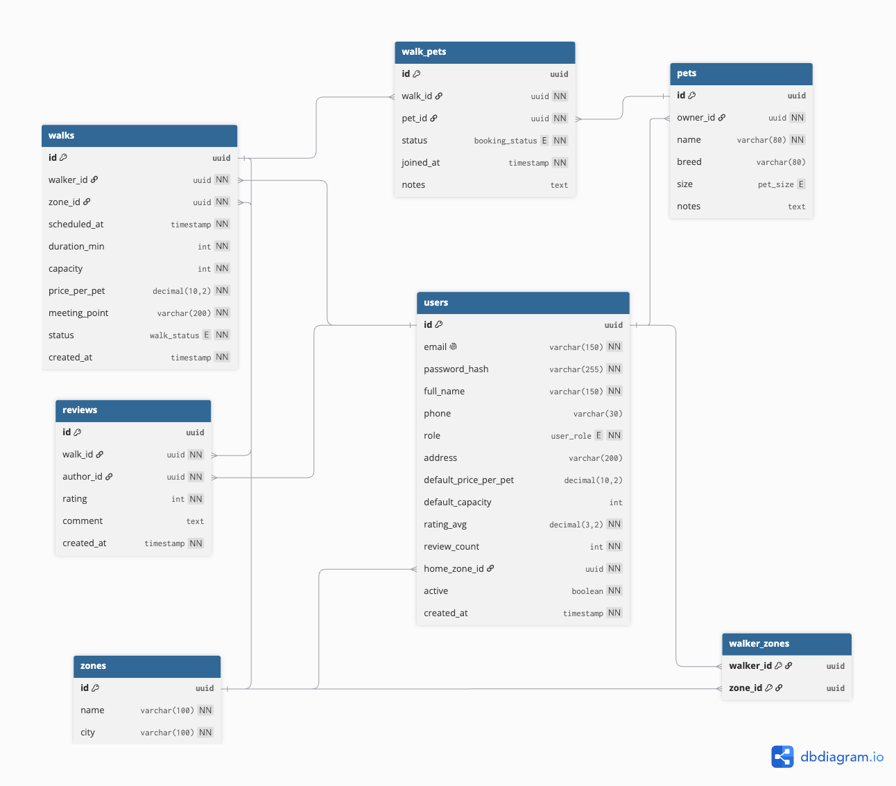

# Paseadores

Paseadores helps dog owners find group walks in Buenos Aires. A walker publishes the neighborhood, time, meeting point, price per pet and number of spots. Owners can see what is available and book a spot for one of their pets.

We built this app as our capstone project for UTN's distance learning program in Computer Programming.

## Team

- Gastón Lell
- Juan Cruz Leal
- Gabriel Lovera

## Table of Contents

- [Purpose](#purpose)
- [MVP Scope](#mvp-scope)
- [Tech Stack](#tech-stack)
- [Architecture](#architecture)
- [Modules](#modules)
- [Data Model](#data-model)
- [Design Decisions](#design-decisions)
- [Installation and Setup](#installation-and-setup)
- [Repository Structure](#repository-structure)
- [Delivery Roadmap](#delivery-roadmap)
- [Final Report and Demo](#final-report-and-demo)

## Purpose

When a group walk is arranged through messages, the meeting point, schedule changes and available spots can end up in different conversations. We wanted walkers and owners to see the same information and have a place to check upcoming and past walks.

## MVP Scope

- Owners and walkers can create accounts and manage their own profiles.
- Walkers set their service neighborhoods, a suggested price and a default capacity. The map gives an approximate view of their coverage.
- Walkers publish group walks and manage them from their schedule. Owners can add pets, search by neighborhood, date or time, and book while there is room.
- Owners can cancel a booking within the allowed window and rebook if a spot is available. The booking screen separates upcoming, in-progress and past walks.
- After a walk is completed, an owner who took part can leave a review.

Prices are shown in Argentine pesos. We did not include online payments, live GPS tracking, in-app chat, a native mobile app, recurring schedules or custom map polygons.

## Tech Stack

| Layer | Technology |
|---|---|
| Frontend | TypeScript, React, Vite and Tailwind CSS; pnpm for dependencies |
| Backend | Java 21, Spring Boot, Spring Data JPA and JDBC |
| Database | PostgreSQL with Flyway migrations |
| Map | Leaflet and OpenStreetMap |
| Authentication | Spring Security, JWT and BCrypt |
| Packaging | A Docker image that serves the web app and API together |

## Architecture

Spring Boot handles requests in a single application. Controllers read HTTP requests, services check permissions and apply the rules for each operation, and repositories read or write data in PostgreSQL. We kept this structure because walks, bookings and reviews work with the same data and do not need separate deployments.

The React app is organized by feature. The `app/` folder contains routing, layout and providers, while `shared/` contains the HTTP client, reusable components and common types. See the [architecture notes](docs/arquitectura.md) and [frontend guide](frontend/README.md).

## Modules

| Module | Backend package | Frontend folder | Responsibility |
|---|---|---|---|
| Authentication | `auth` | `features/auth` | Register, sign in and issue tokens |
| Users and profiles | `user` | `features/profile` | Read and update the signed-in user's profile |
| Walker coverage | `user` | `features/profile`, `features/map` | Manage service areas and defaults; show a walker profile without private contact details |
| Pets | `pet` | `features/pets` | Add, view and edit the owner's pets |
| Zones and map | `zone` | `features/map` | Serve the neighborhood catalog and display approximate coverage |
| Walks and schedule | `walk` | `features/walks` | Publish, view, start, complete and cancel walks |
| Bookings | `walk` | `features/walks`, `features/bookings` | Book and cancel spots, check capacity and show booking history |
| Walk search | `walk` | `features/walks` | Find future walks with spots available |
| Reviews | `review` | `features/reviews`, `features/profile` | Review completed walks and update walker ratings |
| Shared code | `shared` | `app`, `shared` | Routing, configuration, security, validation and error handling |

The [module guide](docs/modulos.md) explains how we check each part.

## Data Model



The model has seven tables: `zones`, `users`, `walker_zones`, `pets`, `walks`, `walk_pets` and `reviews`. See the [data model notes](docs/modelo-datos.md) and the [editable diagram](database/schema.dbml). The [database folder](database/README.md) contains standalone SQL scripts; Flyway applies the [application migrations](backend/src/main/resources/db/migration/) at startup.

## Design Decisions

### One users table with two roles

Owners and walkers share the same account fields, so we keep both in `users`. The `role` column distinguishes a pet owner (`CLIENT`) from a walker (`WALKER`). Service areas are stored separately in `walker_zones`.

### Walkers publish and owners book directly

A future walk with room is an available option. The owner does not wait for the walker to approve the booking. A walker cannot publish two active walks with overlapping times.

### Each booking has its own record

A row in `walk_pets` represents one pet's spot on one walk. It has its own ID, status and booking time. A cancelled row stays in the history and can be reactivated if that pet books again. When two owners try to take the last spot, the booking transaction locks the walk row and checks capacity before confirming.

## Installation and Setup

Use JDK 21, PostgreSQL 14 or later, Node.js 24 and pnpm 11.25.0. Start PostgreSQL and create a database for the app if you do not already have one. Set `DB_URL`, `DB_USER`, `DB_PASSWORD` and `JWT_SECRET` in the backend terminal or in a local `backend/.env` file. Flyway creates the tables and loads the neighborhood catalog on startup.

From the repository root, open two terminals:

```bash
# Terminal 1: backend
cd backend
bash mvnw spring-boot:run
```

```bash
# Terminal 2: frontend
cd frontend
pnpm install --frozen-lockfile
pnpm dev
```

Open the [web app](http://localhost:5173) or [Swagger UI](http://localhost:8080/swagger-ui/index.html). In development, Vite forwards `/api` requests to Spring Boot on port 8080. The [local setup guide](docs/ejecucion-local.md) includes the Git Bash commands for Windows, port checks, test commands and the demo walkthrough.

The [Dockerfile](Dockerfile) builds the frontend into the backend image. The container listens on port 8080 and needs a separate PostgreSQL database and the same four environment variables. Use a private JWT secret for any public deployment.

## Repository Structure

| Path | Contents |
|---|---|
| [backend/](backend/README.md) | Spring Boot API, migrations and Java tests |
| [frontend/](frontend/README.md) | React pages, route guards, forms, API client and frontend tests |
| [database/](database/README.md) | Standalone SQL, verification queries and the editable schema |
| [docs/](docs/) | Design notes, API behavior, local setup and final reports |

## Delivery Roadmap

| Milestone | Deadline | Status |
|---|---|---|
| First delivery: proposal and repository | August 30, 2026 | Complete |
| Second delivery: database design and modules | September 27, 2026 | Complete |
| Final delivery: report, video and deployment | November 11, 2026 | Pending |
| Oral defense | Exam session | Pending |

## Final Report and Demo

- [Final report (English PDF)](docs/paseadores-final-report-en.pdf)
- [Final report (Spanish PDF)](docs/informe-final-paseadores.pdf)
- [Delivery status and demo walkthrough](docs/estado-entrega.md)
- [Demo video](https://drive.google.com/file/d/1tM3KPhU4TORwfLzzkiR_hNMquNya0CiE/view?usp=sharing)
- [Public deployment](https://dog-walk-app.onrender.com/)
