# Dog Walk App

Tecnicatura Universitaria en Programación

Proyecto Final

Grupo 137

Gastón Lell · Gabriel Lovera · Juan Cruz Leal

Año de cursado 2026

<!-- page -->
# Índice

<!-- toc -->

<!-- page -->
# Resumen ejecutivo

Dog Walk App, también llamada Paseadores, es una aplicación web para organizar paseos grupales de perros en la Ciudad de Buenos Aires. Los paseadores publican el barrio, el horario, el punto de encuentro, el precio por mascota y el cupo. Los dueños registran sus mascotas y reservan sobre esas salidas publicadas.

El proyecto responde a una dificultad de coordinación: cuando los datos de un paseo se reparten entre mensajes, es difícil consultar la oferta vigente y llevar un registro compartido de las reservas y los cambios. Nuestro objetivo fue reunir esa información y controlar que solo se confirme una reserva cuando todavía haya lugar.

La versión desarrollada permite registrarse con dos roles, administrar perfiles y mascotas, definir cobertura, publicar y buscar paseos, reservar, cancelar y consultar el historial. Después de que el paseador finaliza una salida, un dueño que participó puede dejar una reseña. La API verifica permisos y reglas de negocio, y PostgreSQL conserva los datos y las restricciones de integridad.

Usamos React y TypeScript para la interfaz, Java 21 con Spring Boot para el backend y PostgreSQL como base de datos. El repositorio incluye pruebas automáticas y capturas reales del recorrido de ambos roles. Este informe explica el problema, el alcance, el diseño, los casos de uso y las validaciones realizadas; también distingue las restricciones actuales de las ampliaciones posibles.

La coordinación de una salida puede completarse dentro del alcance del MVP. No evaluamos todavía la adopción sostenida por usuarios reales ni resultados comerciales. Los pagos y el seguimiento GPS quedan fuera de esta versión.

## Acceso al proyecto

- [Repositorio del equipo](https://github.com/loveragabriel/trabajo-practico-integrador)
- [Aplicación publicada](https://dog-walk-app.onrender.com/)
- [Video de presentación](https://drive.google.com/file/d/1tM3KPhU4TORwfLzzkiR_hNMquNya0CiE/view?usp=sharing)

Antes de la mesa de examen debemos volver a comprobar el acceso público a la aplicación y al video desde una ventana sin sesión.

<!-- page -->
# 1 El problema que quisimos resolver

## Situación inicial

Un dueño necesita encontrar un paseador que trabaje en su barrio y tenga lugar en un horario compatible. El paseador, por su parte, necesita organizar sus salidas y conocer qué mascotas integran cada grupo. Cuando se coordinan por mensajes, la información sobre horarios, puntos de encuentro y cancelaciones puede quedar distribuida entre conversaciones.

En esa forma de organización, confirmar un lugar depende de consultar al paseador y actualizar el registro de cada salida. Si dos dueños consultan por el mismo cupo, o alguien cancela y el cambio no se comunica, la información disponible puede dejar de coincidir con las reservas. También cuesta reconstruir las salidas anteriores y asociar una opinión con un paseo efectivamente realizado.

Elegimos este problema porque permite trabajar sobre una necesidad concreta de coordinación y llevarla a un sistema con información persistente, dos actores y reglas que deben cumplirse incluso ante solicitudes simultáneas. El foco del proyecto es la organización de paseos grupales dentro de CABA.

## Evidencia documental y alcance de la validación

La Encuesta Anual de Hogares 2022 de la Dirección General de Estadística y Censos de la Ciudad estimó 493.676 perros en los hogares porteños. Ese dato, publicado en el informe de tenencia responsable de 2024, permite dimensionar la población vinculada al servicio; corresponde a 2022 y no representa una medición de clientes de nuestra aplicación [R1].

El Sindicato de Trabajadores Caninos publica un estudio de Sandra Wolanski, investigadora del CONICET, sobre la profesionalización y organización del trabajo canino en Buenos Aires [R2]. Lo tomamos como contexto del sector. La nota de LA NACION del 3 de noviembre de 2022 también documenta iniciativas para formalizar esta actividad [R3].

La evidencia utilizada es documental. No realizamos entrevistas ni encuestas propias, y estas fuentes no prueban por sí solas que una aplicación resuelva todas las dificultades del sector. La validación del producto se centró en comprobar el recorrido de organización y reserva con cuentas de ejemplo. Una prueba con dueños y paseadores reales queda como evaluación posterior.

<!-- page -->
# 2 Objetivos y actores

## Objetivo general

Construir una aplicación web respaldada por una base de datos relacional donde los paseadores puedan organizar paseos grupales por barrio y los dueños puedan reservar solo cuando haya lugar.

## Objetivos específicos

- Permitir que un paseador publique en los barrios que cubre y consulte su agenda.
- Permitir que un dueño cargue sus mascotas, busque salidas y reserve para una mascota propia.
- Mantener reservas e historial y controlar los permisos de cancelación, finalización y reseña.
- Evitar reservas que superen el cupo y publicaciones superpuestas para el mismo paseador, incluso ante solicitudes concurrentes.
- Ofrecer un recorrido usable desde pantallas de escritorio y de celular.

## Dueño de mascota

El dueño, identificado como CLIENT en la API, busca un paseo adecuado para su mascota. Puede administrar su perfil y sus mascotas, consultar paseos, reservar, cancelar dentro del plazo y revisar Próximas, En curso e Historial. Después de participar en un paseo finalizado puede escribir una reseña.

Sus reservas y mascotas pertenecen a su cuenta. Conocer el identificador de una mascota ajena no le permite reservar por ella. Tampoco puede publicar paseos ni cambiar sus estados.

## Paseador

El paseador, identificado como WALKER, define dónde ofrece el servicio y organiza las salidas. Puede configurar su cobertura y valores sugeridos, publicar paseos, consultar su agenda y ver las mascotas inscriptas en sus propias salidas. También inicia, finaliza o cancela esos paseos y consulta las reseñas recibidas.

La cobertura de servicio puede abarcar varios barrios y es distinta del barrio de residencia del perfil. El paseador no puede administrar la agenda de otro paseador ni reservar como dueño. Cada cuenta tiene uno de los dos roles; no incorporamos un panel de administración como tercer actor.

<!-- page -->
# 3 Alcance y requisitos

El MVP cubre desde la creación de la cuenta hasta la reseña de una salida finalizada. Cada rol tiene su propia navegación. El catálogo de barrios es público porque se usa al registrarse; la consulta de paseos, reservas y perfiles de otros paseadores requiere iniciar sesión.

| Requisito | Comportamiento implementado |
|---|---|
| RF01 Cuentas y perfiles | Registro e ingreso de ambos roles, edición de datos propios y protección de los datos privados del perfil. |
| RF02 Cobertura del servicio | Selección de barrios de servicio y valores sugeridos de precio y cupo para el paseador. |
| RF03 Publicación y agenda | Alta de una salida futura con duración, precio, cupo y punto de encuentro. Consulta de próximas salidas e historial y control de superposición. |
| RF04 Mascotas y búsqueda | Alta y edición de mascotas propias y búsqueda de paseos por barrio, fecha u horario, con detalle y disponibilidad. |
| RF05 Reserva | Inscripción de una mascota propia en un paseo con lugar antes de la hora de inicio y consulta de Mis reservas. |
| RF06 Cancelación y estados | Cancelación dentro del plazo, liberación del cupo, nueva reserva e inicio, finalización o cancelación por el paseador responsable. |
| RF07 Reseñas | Una reseña por dueño participante y paseo finalizado, con actualización del promedio y la cantidad de reseñas del paseador. |

## Criterios de calidad

Las reglas se verifican en el servidor; ocultar un botón en la interfaz no reemplaza un control de permisos. Las claves y restricciones de PostgreSQL protegen la integridad de los datos, y las transacciones agrupan los cambios que deben confirmarse juntos.

Las pruebas automáticas cubren servicios, controladores, contratos y comportamiento de la interfaz. Las pruebas de integración que necesitan PostgreSQL se ejecutan de forma explícita en una base de prueba. El informe conserva la evidencia del recorrido manual y explica qué verificaciones se pudieron repetir en esta revisión.

<!-- page -->
# 4 Restricciones y trabajo futuro

## Restricciones de esta versión

- El servicio opera con barrios predefinidos de la Ciudad de Buenos Aires. No admite que el usuario dibuje nuevas zonas.
- Todos los precios se interpretan y muestran en pesos argentinos. La moneda es una regla de negocio de esta versión; no hay conversión ni selección de divisa.
- Los horarios se interpretan en la hora local de Buenos Aires. No implementamos agenda internacional ni selección de zona horaria.
- La reserva se confirma directamente sobre una salida publicada, sin una etapa de aceptación del paseador. Cada solicitud incorpora una mascota.
- El mapa ubica el barrio de manera aproximada. El punto de encuentro es texto; no representa geolocalización en vivo ni certifica el recorrido del paseo.
- La calificación corresponde a una participación en un paseo finalizado. La aplicación no verifica habilitaciones profesionales del paseador.

## Funcionalidades fuera del MVP

| Posible ampliación | Motivo del recorte y trabajo que requeriría |
|---|---|
| Pagos en línea | Priorizamos la publicación y reserva. Incorporarlos requiere integrar un proveedor, registrar estados de pago y definir devoluciones y conciliación. |
| Seguimiento GPS | Requiere ubicación durante la salida, permisos del dispositivo y decisiones de privacidad. No era necesario para validar la gestión de cupos. |
| Chat y notificaciones | El estado de la reserva ya puede consultarse en la app. Un canal de mensajería y avisos necesita entrega, almacenamiento y permisos adicionales. |
| Aplicación móvil nativa | La primera entrega usa una web adaptable. Una app nativa requeriría otro ciclo de desarrollo y publicación. |
| Paseos recurrentes | Cada salida tiene su propio horario y cupo. Las recurrencias requieren reglas para excepciones, cancelaciones y solapamientos de series. |
| Zonas dibujadas en el mapa | El catálogo de barrios alcanza para el alcance territorial definido. Los polígonos exigirían un modelo geoespacial y nuevas búsquedas. |

Estas opciones no están implementadas ni probadas. Las consideramos posibles iteraciones para priorizar después de evaluar el MVP con usuarios. No comprometemos fechas. La multimoneda y la expansión a otras ciudades tampoco forman parte del alcance acordado.

<!-- page -->
# 5 Arquitectura y tecnologías

La solución usa una aplicación React que consume una API REST en JSON. El backend es un monolito organizado en capas y módulos de negocio. Comparten una base PostgreSQL porque perfiles, paseos, reservas y reseñas utilizan la misma información.

| Componente | Tecnología y motivo de elección |
|---|---|
| Interfaz | React y TypeScript permiten organizar las pantallas en componentes y describir los datos de formularios y respuestas. Los tipos ayudan durante el desarrollo; el servidor vuelve a validar los datos. |
| Desarrollo frontend | Vite compila la aplicación y ofrece el servidor de desarrollo. pnpm mantiene las dependencias con un archivo de versiones bloqueadas. Tailwind CSS concentra los estilos de la interfaz. |
| API y negocio | Java 21 y Spring Boot integran controladores, validaciones, inyección de dependencias y transacciones. Pudimos aplicar la separación de responsabilidades trabajada durante la cursada. |
| Persistencia | Spring Data JPA administra entidades y operaciones de escritura. JDBC permite consultas de lectura con filtros, conteos y datos de varias tablas sin enviar las entidades completas a la pantalla. |
| Base de datos | PostgreSQL aporta claves foráneas, restricciones, tipos enumerados y bloqueos transaccionales para cupos y agenda. |
| Migraciones | Flyway crea el esquema y carga el catálogo de barrios de forma versionada. Evita depender de cambios manuales distintos en cada instalación. |
| Seguridad | Spring Security integra autenticación y acceso. JWT identifica solicitudes y BCrypt permite almacenar un hash de la contraseña. |
| Mapa y contrato | Leaflet muestra mapas con datos de OpenStreetMap. Springdoc genera el contrato OpenAPI y Swagger permite consultar y probar los endpoints. |
| Distribución | Docker compila la interfaz y la incorpora al backend para publicar un único servicio junto con una base PostgreSQL separada. |

En desarrollo, Vite reenvía /api al puerto 8080. En producción, Spring Boot sirve tanto los archivos de la interfaz como la API, lo que simplifica el despliegue del MVP.

<!-- page -->
# 6 Módulos y responsabilidades

Cada módulo agrupa una responsabilidad del sistema. En el backend usamos paquetes de negocio; en el frontend, carpetas de funcionalidades. Las reglas compartidas de seguridad y errores quedan en shared.

| Módulo | Responsabilidad y ubicación principal |
|---|---|
| Autenticación | auth registra usuarios, verifica contraseñas y emite tokens. features/auth contiene ingreso y registro. |
| Usuarios y perfiles | user consulta y actualiza el perfil propio. features/profile muestra los datos de la cuenta y del paseador. |
| Paseadores y cobertura | WalkerCoverageService administra barrios de servicio y valores sugeridos. La interfaz usa features/profile y features/map. |
| Mascotas | pet controla pertenencia y datos de cada mascota. features/pets contiene el listado y los formularios del dueño. |
| Zonas y mapa | zone expone el catálogo; features/map ubica los barrios y la cobertura. Los barrios no se crean desde la interfaz. |
| Paseos y agenda | WalkService, en walk, crea salidas, busca, devuelve el detalle y administra la agenda y los estados. features/walks contiene las pantallas del recorrido. |
| Reservas | BookingService coordina identidad, mascota y bloqueo del paseo. WalkPetService aplica las reglas de inscripción y cancelación. Ambos pertenecen a walk; no existe otra tabla llamada bookings. |
| Reseñas | review valida la participación y el estado del paseo y registra la calificación. features/reviews permite enviarla y mostrarla. |
| Funciones compartidas | shared contiene seguridad, errores, validaciones y tipos comunes. app conecta las rutas, el diseño general y los proveedores de React. |

Los controladores reciben solicitudes y devuelven respuestas HTTP. Los servicios deciden si la operación puede realizarse. Los repositorios consultan o modifican los datos. Mantener esas responsabilidades separadas permite probar las reglas sin depender de la pantalla y conservar el mismo control para cualquier cliente de la API.

<!-- page -->
# 7 Decisiones de implementación

## Una aplicación con capas

Elegimos un monolito porque los módulos comparten datos y el alcance no requiere despliegues independientes. Separar los servicios en procesos distintos habría agregado comunicación entre sistemas y coordinación de transacciones sin aportar una ventaja necesaria para esta entrega.

El frontend muestra la información y solicita operaciones. La decisión sobre cupos, titularidad o transiciones corresponde al backend. PostgreSQL agrega la última protección mediante claves, restricciones y transacciones. Ninguna de esas responsabilidades se reemplaza con una validación visual.

## Un paseo publicado representa disponibilidad

El paseador publica una salida con horario y cupo. El dueño elige entre esas ofertas, por lo que no necesitamos una tabla adicional de disponibilidad semanal ni un circuito de solicitud y aceptación. La agenda se obtiene de los paseos existentes. La búsqueda excluye salidas sin lugar o cuya hora de inicio ya llegó.

## Entidades y datos de la API

Una entidad representa información persistida, como Walk o WalkPet. Un DTO es un objeto de transferencia de datos que describe lo que entra o sale de una operación. Por ejemplo, WalkCreateRequest recibe los datos de publicación y WalkReadResponse devuelve el detalle con la disponibilidad calculada.

Al pulsar Iniciar paseo, React envía PATCH /api/walks/{id}/status con el estado IN_PROGRESS. WalkStatusUpdateRequest es el DTO de entrada: contiene un estado obligatorio del enum WalkStatus. El controlador valida el formato y entrega la solicitud a WalkService.updateStatus, que verifica quién actúa y si la transición está permitida. El DTO no decide los permisos.

## Reservas y lecturas

WalkPet es una entidad propia porque la inscripción tiene identificador, estado y fecha. Cancelar conserva el registro y volver a reservar reactiva esa misma relación. BookingService coordina el caso de uso; WalkPetService concentra sus reglas. Las consultas JDBC preparan vistas de lectura paginadas para la agenda, búsqueda y reservas, sin trasladar esa composición a React.

<!-- page -->
# 8 Entidades principales

## Usuario y barrio

User representa una cuenta. Guarda identidad, correo, hash de contraseña, teléfono opcional, barrio y estado activo. Su rol puede ser CLIENT o WALKER. Usamos una sola tabla users porque ambos actores comparten esos datos; los valores de precio, capacidad y calificación se utilizan para el paseador.

Zone representa un barrio del catálogo de CABA. Tiene un identificador, nombre y ciudad. Un barrio puede ser residencia de muchos usuarios y ubicación de muchos paseos. La residencia del usuario no determina automáticamente todos los barrios donde un paseador ofrece servicio.

## Cobertura y mascota

La tabla walker_zones vincula un usuario paseador con un barrio de servicio. La clave compuesta impide repetir el mismo par. Esta asociación resuelve la relación muchos a muchos entre paseadores y barrios: un paseador cubre varios barrios y en un barrio trabajan varios paseadores.

Pet representa una mascota de un dueño. Guarda nombre y datos opcionales de raza, tamaño y notas. Cada mascota tiene un único owner_id y un dueño puede registrar varias mascotas. El servicio verifica que la cuenta autenticada sea titular antes de editarla o utilizarla en una reserva.

## Paseo, reserva y reseña

Walk representa una salida grupal publicada por un paseador en un barrio. Guarda inicio, duración, capacidad, precio por mascota, punto de encuentro y estado. PostgreSQL deriva end_time a partir del inicio y la duración para consultar superposiciones de horario.

WalkPet representa la reserva de una mascota en un paseo. Relaciona walk_id y pet_id y conserva estado, fecha de incorporación y notas. El par paseo y mascota es único; una cancelación cambia el estado a CANCELLED, sin eliminar el registro.

Review representa la valoración de un dueño sobre un paseo finalizado en el que participó. Relaciona paseo y autor, con puntaje de uno a cinco, comentario opcional y fecha. Un dueño puede publicar una reseña por paseo, aunque haya reservado para varias mascotas.

Las relaciones se materializan con claves foráneas. Varias entidades Java conservan los identificadores UUID de sus referencias; la integridad relacional no depende de que cada vínculo esté representado como un objeto anidado de JPA.

<!-- page -->
# 9 Relaciones e integridad de los datos

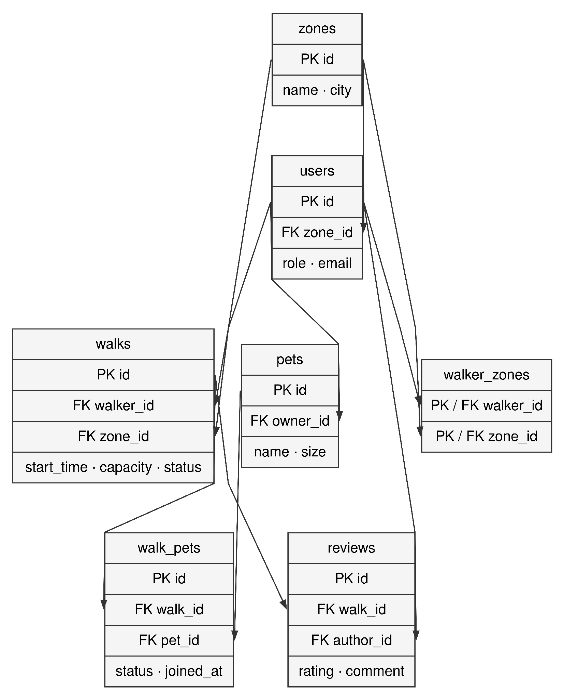

Figura A. Modelo simplificado. PK indica clave primaria y FK indica clave foránea. El esquema completo está en las migraciones y en database/schema.dbml.

Un usuario tiene muchas mascotas y un paseador publica muchos paseos. Un paseo admite varias mascotas y una mascota puede participar en varios paseos; walk_pets guarda esa relación y su estado. Las reseñas se vinculan con un paseo y con el dueño que las escribió.

## Restricciones que conserva PostgreSQL

- Correo único sin distinguir mayúsculas y minúsculas, y pares únicos para barrio y ciudad, paseador y barrio, paseo y mascota, paseo y autor de reseña.
- Claves foráneas que exigen la existencia de las referencias; cupos y duraciones positivos, precios no negativos y calificaciones entre uno y cinco.
- Tipos enumerados para roles y estados. La validez de una transición se comprueba en los servicios, no solamente con el enum.
- Cancelación mediante cambio de estado para conservar el historial. La primera migración crea las tablas y la segunda incorpora los barrios.

<!-- page -->
# 10 Reglas de negocio

## Publicación y agenda

- Un paseador publica únicamente en un barrio de su cobertura.
- El inicio debe tener al menos dos horas de anticipación. La duración mínima es de 30 minutos y debe ser múltiplo de 15.
- El cupo debe ser positivo y el precio no negativo. Una salida puede ser gratuita; la moneda de los importes es ARS.
- Dos paseos activos del mismo paseador no pueden superponerse. La comprobación usa inicio y fin; permite salidas contiguas sin superposición.

## Reserva y cancelación

- Solo un dueño activo puede reservar y debe elegir una mascota propia. La salida debe seguir publicada, con lugar y con inicio posterior al momento de la solicitud.
- No se admite una segunda reserva activa de la misma mascota para el mismo paseo. Cada solicitud incorpora una mascota; el cupo se cuenta por mascota.
- Para cancelar una reserva, el paseo debe estar programado y deben faltar más de dos horas. A exactamente dos horas se rechaza la cancelación.
- Cancelar libera un lugar y mantiene el registro. Reservar otra vez reactiva la relación existente, si la salida todavía admite inscripciones.

## Estados y reseñas

- PUBLISHED y FULL indican una salida programada con lugar o sin lugar. El servicio cambia entre ambos al incorporar o cancelar reservas.
- El paseador responsable puede pasar una salida programada a IN_PROGRESS si tiene al menos una mascota inscripta. Puede finalizarla desde IN_PROGRESS hacia COMPLETED.
- El responsable puede cancelar una salida publicada, completa o en curso. Se cancelan también sus reservas activas. COMPLETED y CANCELLED son estados finales.
- Solo un dueño participante puede reseñar un paseo COMPLETED, una vez por paseo. Guardar la reseña y actualizar el promedio del paseador forman parte de la misma transacción.

El servidor usa un Clock configurado con la hora de Buenos Aires. Las pruebas pueden fijar ese reloj para comprobar de manera repetible los límites de publicación, reserva y cancelación.

<!-- page -->
# 11 Seguridad y recorrido de una solicitud

## Autenticación

Al registrarse, la contraseña se transforma con BCrypt y se guarda su hash. BCrypt no es un cifrado reversible: al ingresar se compara la contraseña presentada con ese hash. Si las credenciales son correctas, el backend emite un token JWT.

El cliente HTTP del frontend adjunta el token como Bearer en las solicitudes protegidas. JwtAuthenticationFilter verifica el token y establece la identidad usada por Spring Security. La API trabaja sin una sesión de servidor por usuario. Un token ausente o inválido produce una respuesta 401; una acción no permitida se rechaza con 403 cuando corresponde.

## Autorización y privacidad

Los servicios validan el rol, que la cuenta esté activa y la titularidad del recurso. El ID recibido en la URL no concede permiso. Un dueño no puede editar una mascota ajena, y un paseador no puede cambiar el estado ni consultar las mascotas inscriptas de una salida que no le pertenece.

El perfil de otro paseador omite correo y teléfono privados. Para coordinar una salida, el paseador responsable sí puede consultar los contactos de los dueños de las mascotas inscriptas. La interfaz adapta sus opciones al rol; la protección definitiva está en la API.

## De la pantalla a la base

En una reserva, React envía POST /api/walks/{id}/join/{petId}. El controlador obtiene la identidad autenticada. BookingService verifica el rol y la mascota, bloquea el paseo y delega la inscripción a WalkPetService. Allí se revisan estado, inicio, duplicados y cupo antes de confirmar.

Los DTO y las anotaciones de validación controlan formatos y campos obligatorios. Las excepciones se transforman en errores JSON consistentes, que la interfaz puede mostrar junto al formulario. La transacción se revierte si falla una regla.

DB_URL, DB_USER, DB_PASSWORD y JWT_SECRET se obtienen del entorno o de un archivo local no versionado. El repositorio ofrece un ejemplo de configuración, sin publicar las credenciales del despliegue.

<!-- page -->
# 12 Plan de pruebas y metodología

Probamos el sistema en varios niveles porque una pantalla que permite reservar no demuestra por sí sola que se respeten los permisos o el cupo cuando llegan dos solicitudes al mismo tiempo.

## Pruebas automáticas

Las pruebas unitarias de servicios comprueban reglas y errores con dependencias controladas. Las pruebas web verifican solicitudes, validaciones y respuestas de los controladores. ArchUnit comprueba reglas de dependencias entre paquetes para mantener la organización de capas y módulos.

Las pruebas de integración usan PostgreSQL y se habilitan con TPI_DB_TESTS=true. Comprueban persistencia, consultas y concurrencia reales. Dos transacciones intentan reservar el último lugar, y otra prueba intenta publicar dos salidas superpuestas del mismo paseador. El resultado esperado es que solo una solicitud pueda concretarse en cada conflicto. Estas pruebas deben ejecutarse en una base separada de la utilizada por la aplicación.

En el frontend comprobamos filtros, clasificación de reservas, reglas de presentación y cliente HTTP. El build de producción también revisa los tipos de TypeScript, y el lint busca problemas estáticos. Estas comprobaciones no sustituyen una prueba de interacción en el navegador.

## Recorrido manual y adaptación móvil

Con cuentas de ejemplo recorrimos ambos roles: cobertura, publicación, alta de mascota, búsqueda, reserva, cancelación, nueva reserva, inicio, finalización y reseña. Verificamos que los cambios se reflejaran al consultar desde la otra cuenta y que la reserva apareciera en la sección correspondiente.

Revisamos las pantallas del dueño con un ancho de 390 píxeles para representar un celular de formato estrecho. Comprobamos la lectura de tarjetas, los controles de búsqueda y reserva y la visualización de la reseña. Ese ancho es una muestra de responsividad; no equivale a probar todos los dispositivos ni a una auditoría completa de accesibilidad.

Las figuras de los casos de uso conservan las capturas reales de esa validación. Las cuentas y mascotas son ficticias. Se usan para demostrar comportamiento funcional, no como testimonios de usuarios del servicio.

<!-- page -->
# 13 Resultados y estado de la validación

## Registro de la validación inicial

En la validación inicial del proyecto registramos 211 pruebas de backend aprobadas con Java 21 y PostgreSQL 17, incluidas las de integración, y 51 de frontend. Conservamos las capturas del recorrido de ambos roles y del dueño a 390 píxeles. Ese resultado corresponde a la validación inicial, no a una ejecución nueva.

| Verificación del recorrido | Resultado registrado |
|---|---|
| Publicación superpuesta | Dos intentos concurrentes del mismo paseador no pudieron concretarse ambos. |
| Último lugar | Solo una de dos solicitudes concurrentes pudo confirmar la reserva. |
| Cancelación y nueva reserva | Se liberó el cupo, la cancelación quedó en Historial y la reserva pudo reactivarse. |
| Permisos y estados | Se verificaron titularidad, transiciones y rechazo de inscripciones al llegar la hora de inicio. |
| Finalización y reseña | Un dueño participante pudo calificar una salida finalizada y se actualizó la calificación del paseador. |

## Revisión del 24 de noviembre de 2026

Repetimos las 51 pruebas del frontend, sin fallos ni pruebas omitidas. También finalizaron correctamente el lint y el build de producción. Vite advierte que un archivo JavaScript supera 500 kB después de minificar; la compilación termina y la división del bundle queda como mejora de rendimiento.

Las últimas ejecuciones disponibles de GitHub Actions para backend y frontend finalizaron correctamente [R6, R7]. El workflow de backend no habilita las pruebas con base de datos, por lo que su aprobación no demuestra por sí sola la concurrencia real.

Intentamos repetir Maven en el entorno de revisión, pero no pudo resolver el nombre de Maven Central para descargar Spring Boot. La compilación no llegó a ejecutarse; ese intento no confirma ni invalida las 211 pruebas del registro anterior. La revisión actual modifica documentación, no el código de la aplicación.

La aplicación y el video tienen enlaces publicados en el README. Antes de presentarnos en mesa falta volver a verificar acceso anónimo, persistencia y recorrido completo en el despliegue público. No damos esa comprobación por realizada solo por tener un enlace.

<!-- page -->
# 14 Casos de uso relevantes

Los casos siguientes muestran el recorrido principal del MVP. Elegimos estos porque conectan los objetivos de organización y disponibilidad con acciones de ambos actores. Cada caso indica sus condiciones, los pasos realizados y el resultado observado. Las capturas corresponden a la validación inicial; los escenarios automáticos se describen en el plan de pruebas.

## CU01 Definir cobertura y publicar un paseo

Actor principal: paseador. Condición previa: cuenta activa con rol WALKER. El paseador configura Palermo como barrio de servicio y define valores sugeridos. Luego publica una salida futura con horario, duración, punto de encuentro y cupo.

El servidor verifica cobertura, anticipación y ausencia de superposición. La confirmación permite volver a la agenda y compartir el enlace por WhatsApp. El resultado esperado y registrado es que la salida figure en Próximas salidas. Un segundo intento en un horario superpuesto se rechaza.

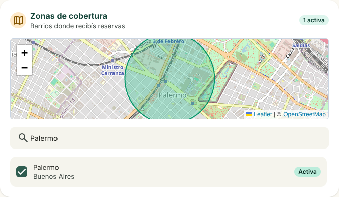

Figura 1. Palermo incorporado a la cobertura del paseador.

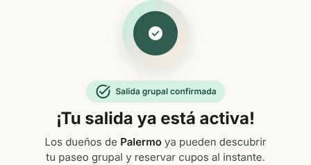

Figura 2. Confirmación de la salida publicada.

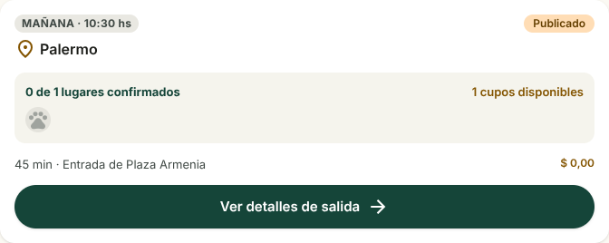

Figura 3. La agenda muestra horario, cupo y punto de encuentro del paseo.

<!-- page -->
# 14 Casos de uso relevantes

## CU02 Registrar una mascota y buscar un paseo

Actor principal: dueño. Condición previa: cuenta CLIENT. Registramos a Sofía y cargamos a Luna en el segundo paso. El dueño también puede administrar sus mascotas después del registro.

Buscamos por Palermo y fecha. El resultado mostró horario, punto de encuentro, precio y un lugar disponible. El barrio permite acotar el servicio territorialmente; la fecha y el horario permiten elegir una salida compatible. Sin un barrio explícito, el backend utiliza el barrio del perfil.

El resultado esperado y registrado es una oferta futura con lugar. Las salidas cuyo horario de inicio ya llegó quedan fuera de la búsqueda. Si no existen coincidencias, la pantalla debe mostrar ese estado sin inventar disponibilidad.

Figura 4. La mascota del dueño aparece en Mis mascotas.

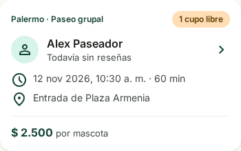

Figura 5. Resultado con horario, precio y disponibilidad antes de reservar.

<!-- page -->
# 14 Casos de uso relevantes

## CU03 Reservar y cancelar un lugar

Actor principal: dueño. Condiciones previas: mascota propia y salida publicada, futura y con lugar. Seleccionamos a Luna y reservamos el único cupo. El resultado esperado y registrado es una confirmación en Próximas y un paseo sin lugares disponibles.

Cancelamos cuando faltaban más de dos horas, comprobamos el registro en Historial y verificamos que el lugar volviera a estar disponible. Después reservamos otra vez para la misma mascota; se reactivó el registro existente. Una mascota ajena, un paseo lleno o una solicitud a partir del inicio se rechazan.

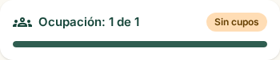

Figura 6. El detalle refleja que el único lugar está ocupado.

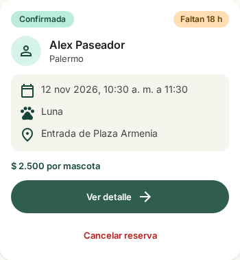

Figura 7. La reserva confirmada aparece en Próximas del dueño.

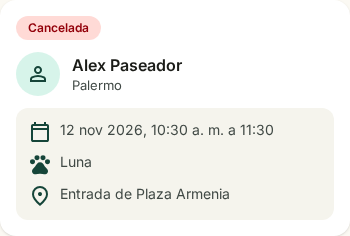

Figura 8. La cancelación conserva el registro en Historial.

<!-- page -->
# 14 Casos de uso relevantes

## CU04 Finalizar y reseñar un paseo

Actores: paseador y dueño participante. Condición previa: al menos una mascota inscripta. El paseador responsable inicia el paseo y luego lo finaliza. El dueño consulta Historial, selecciona Calificar paseo y envía cinco estrellas.

El resultado esperado y registrado es una reseña vinculada al paseo y el promedio actualizado en el perfil del paseador. Se rechazan una reseña antes de finalizar, una reseña de alguien que no participó y una segunda reseña del mismo dueño para esa salida.

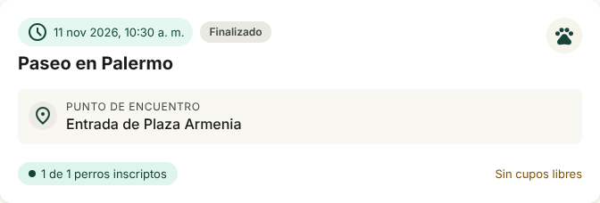

Figura 9. El paseo figura como finalizado en la vista del paseador.

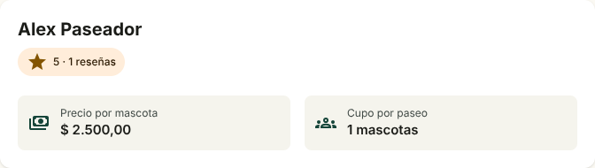

Figura 10. El perfil refleja cinco estrellas y una reseña.

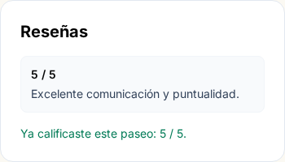

Figura 11. La reseña publicada en una pantalla de 390 píxeles.

<!-- page -->
# 14 Casos de uso relevantes

## CU05 Consultar el paseo en curso

Actores: paseador y dueño con reserva activa. El paseador consulta las mascotas inscriptas e inicia su propia salida. El dueño la encuentra en En curso al volver a consultar sus reservas. La categoría responde al estado que cambió el paseador; no se finaliza automáticamente por transcurrir el horario previsto.

El resultado esperado y registrado es que ambas cuentas consulten el mismo estado. La información de las mascotas y sus dueños solo puede consultarla el paseador responsable de esa salida.

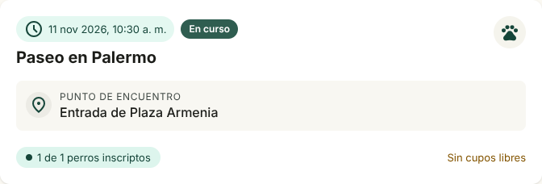

Figura 12. La vista del paseador muestra el estado En curso.

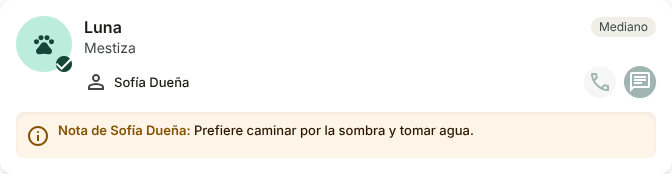

Figura 13. El responsable consulta la mascota inscripta y sus notas.

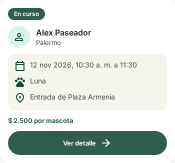

Figura 14. La reserva del dueño aparece en En curso.

<!-- page -->
# 15 Dificultades técnicas y resolución

## Evitar dos reservas sobre el último lugar

Consultar el cupo y guardar una reserva en operaciones independientes deja una condición de carrera: dos solicitudes pueden leer el mismo lugar libre. BookingService abre una transacción y WalkRepository obtiene la fila del paseo con un bloqueo PESSIMISTIC_WRITE, equivalente a SELECT FOR UPDATE. La segunda transacción espera y comprueba la disponibilidad después del cambio de la primera. La prueba de integración envía dos intentos concurrentes y exige una sola confirmación.

## Controlar la agenda cuando aún no hay filas

Bloquear paseos existentes no alcanza cuando se publican dos primeras salidas del mismo paseador al mismo tiempo. WalkService toma un pg_advisory_xact_lock con una clave derivada de su identificador y luego consulta superposiciones. Así serializa las publicaciones de esa agenda hasta que termina la transacción. Las agendas de otros paseadores no comparten deliberadamente esa clave. La prueba concurrente cubre específicamente la creación del primer paseo.

## Conservar el historial y coordinar estados

Eliminar una reserva cancelada dificultaría reconstruir el recorrido de una mascota. La entidad WalkPet conserva el registro y su estado; la nueva inscripción reactiva la misma relación. Los estados PUBLISHED y FULL se recalculan con las reservas activas, mientras que el paseador solicita inicio, finalización o cancelación. Las pruebas revisan límites horarios, transición y clasificación en Próximas, En curso e Historial.

## Integrar módulos sin duplicar decisiones

Una reserva necesita datos de usuario, mascota y paseo. BookingService coordina esos servicios y WalkPetService concentra las reglas de inscripción. Esta separación evita duplicar permisos en React y en los controladores y mantiene una dirección de dependencias que verificamos con ArchUnit.

## Preparar una instalación reproducible

El frontend y la API se ejecutan por separado en desarrollo, con proxy de Vite, y juntos en la imagen Docker de producción. Flyway aplica el esquema versionado al iniciar. Las variables de entorno separan la configuración local del despliegue y evitan guardar contraseñas en Git. La persistencia de PostgreSQL debe configurarse y verificarse por separado del contenedor de la aplicación.

<!-- page -->
# 16 Instalación y demostración

## Base de datos y configuración

Se necesita JDK 21, PostgreSQL 14 o superior, Node.js 24 y pnpm 11.25.0. Crear una base vacía una sola vez, o conservar la base de Paseadores existente. Flyway crea las tablas y carga los barrios al iniciar; no se ejecutan además los scripts manuales sobre ese mismo esquema.

Configurar DB_URL, DB_USER, DB_PASSWORD y JWT_SECRET en la terminal o en backend/.env no versionado. Una URL local de ejemplo es jdbc:postgresql://localhost:5432/paseadores. La contraseña y la clave JWT deben corresponder a cada instalación.

## Ejecución local

Desde la raíz, abrir dos terminales. En la primera entrar en backend y ejecutar bash mvnw spring-boot:run. En Git Bash de Windows puede usarse ./mvnw.cmd spring-boot:run; ./mvnw.cmd -v permite verificar que Maven se ejecuta con JDK 21. Si la terminal ya está en backend, no repetir cd backend.

En la segunda terminal entrar en frontend, ejecutar pnpm install --frozen-lockfile y luego pnpm dev. La interfaz abre en http://localhost:5173 y Vite reenvía /api al backend en http://localhost:8080. Swagger está en http://localhost:8080/swagger-ui/index.html. Si otro proyecto ocupa el puerto 5173, detener ese proceso desde su terminal o usar pnpm dev --port 5174.

## Recorrido y enlaces publicados

1. Crear una cuenta de paseador, agregar un barrio de cobertura y publicar una salida futura con un lugar.
2. Desde otra sesión, crear una cuenta de dueño, agregar una mascota, buscar la salida y reservar.
3. Cancelar con más de dos horas de anticipación, consultar Historial y volver a reservar.
4. Iniciar y finalizar desde el paseador; consultar En curso e Historial desde el dueño y dejar la reseña.

[Aplicación pública](https://dog-walk-app.onrender.com/) · [Video de presentación](https://drive.google.com/file/d/1tM3KPhU4TORwfLzzkiR_hNMquNya0CiE/view?usp=sharing)

La imagen Docker sirve interfaz y API en el puerto 8080 y necesita PostgreSQL persistente por separado. La guía docs/ejecucion-local.md contiene los comandos y las pruebas. Antes del examen hay que comprobar el recorrido y los enlaces sin depender de la sesión de un integrante.

<!-- page -->
# 17 Equipo y uso de herramientas

## Organización del trabajo

Planificamos las tareas en ClickUp y colaboramos mediante GitHub. Juan Cruz trabajó en el análisis, la búsqueda, la publicación, la agenda, el detalle y la integración de los recorridos. Gabriel trabajó en el esquema y los scripts de la base de datos, y Gastón organizó la estructura del proyecto y avanzó en las funcionalidades del paseador. Todos aportamos funcionalidades, pruebas y correcciones durante la integración.

Usamos ramas y pull requests para revisar cambios antes de incorporarlos a main. En las revisiones compartimos los cambios de cada módulo, acordamos los contratos de la API y comprobamos que el recorrido del dueño y del paseador siguiera funcionando al integrar los aportes.

## Herramientas con inteligencia artificial

Utilizamos Google Stitch como apoyo para definir las pantallas del flujo del dueño, en particular búsqueda, detalle y reserva. Adaptamos esas propuestas a los componentes, datos y operaciones de nuestra aplicación.

También utilizamos ChatGPT y Codex como apoyo para revisar código, proponer ajustes y pruebas, organizar la documentación y preparar explicaciones técnicas. Las propuestas se contrastaron con el código del repositorio y con las validaciones disponibles. Las decisiones y la revisión final corresponden al equipo.

El equipo mantuvo la responsabilidad de entender y explicar las reglas de negocio. Las herramientas nos ayudaron a comparar alternativas y revisar propuestas; para comprobar el funcionamiento usamos las pruebas y el recorrido de la aplicación. Las capturas incluidas provienen de ese recorrido.

## Revisión previa a la mesa

- Revisar el informe entre los tres integrantes y confirmar la distribución de la exposición.
- Verificar que el video y la aplicación sean accesibles sin permisos especiales y desde una ventana sin sesión.
- Repetir el recorrido publicado y confirmar que PostgreSQL conserva los datos al reiniciar la aplicación.
- Ejecutar las pruebas de integración en una base separada y conservar el resultado de esa ejecución.

<!-- page -->
# 18 Conclusiones

Partimos de una necesidad de coordinación: reunir la información de una salida y saber qué mascotas tienen un lugar confirmado. Dentro del alcance del MVP, logramos que el paseador publique una oferta y que el dueño la encuentre, reserve y consulte sus cambios desde una misma aplicación.

Respecto de la situación inicial, el horario, el punto de encuentro y los lugares disponibles ya no necesitan reconstruirse desde conversaciones diferentes. Las reservas quedan asociadas a una mascota y a una salida, las cancelaciones liberan el cupo sin borrar el historial y ambos actores pueden consultar el estado. La participación registrada también permite vincular una reseña con un paseo finalizado.

Las pruebas y el recorrido con cuentas de ejemplo muestran que el sistema resuelve ese circuito funcional y aplica permisos y controles de cupo. Esto no demuestra todavía una reducción medida de errores en un servicio real ni adopción por parte de dueños y paseadores. Para evaluar ese impacto necesitamos una prueba con usuarios y observación del uso sostenido.

El desarrollo nos permitió integrar modelado relacional, programación de servicios, transacciones, autenticación y construcción de interfaces. Los casos del último lugar y la agenda superpuesta nos exigieron pensar las reglas más allá de lo que muestra una pantalla y verificar qué ocurre cuando hay solicitudes simultáneas.

Como continuación, consideraríamos pagos, notificaciones, seguimiento de salidas y recurrencias, en el orden que justifique una evaluación con usuarios. Quedaron fuera de esta entrega para priorizar el MVP de publicación y reserva; cada ampliación requiere nuevas reglas y pruebas. Las restricciones actuales, como la operación en CABA y los importes en pesos argentinos, siguen vigentes hasta que exista una decisión explícita de ampliar el alcance.

La revisión conjunta y la comprobación final del despliegue nos permitirán presentar el mismo recorrido y explicar sus decisiones durante la defensa. El valor que pudimos comprobar hasta esta instancia es que ambos actores pueden organizar una salida, consultar su disponibilidad y seguir sus cambios con un registro compartido.

<!-- page -->
# Anexo API principal

La API intercambia JSON. Las operaciones protegidas necesitan un token Bearer. Swagger describe los campos y respuestas completos; la tabla resume las rutas del recorrido.

| Método y ruta | Operación |
|---|---|
| POST /api/auth/register | Registrar una cuenta con rol CLIENT o WALKER. |
| POST /api/auth/login | Validar credenciales y obtener el token. |
| GET /api/zones | Consultar el catálogo público de barrios. |
| GET / PUT /api/walkers/me | Leer o actualizar cobertura y valores sugeridos del paseador. |
| GET / POST /api/pets | Consultar las mascotas propias o agregar una. |
| GET / POST /api/walks | Buscar salidas disponibles o publicar una. |
| GET /api/walks/mine | Consultar próximas salidas o historial del paseador. |
| GET /api/walks/{id} | Consultar un detalle visible para la cuenta autenticada. |
| GET /api/walks/{id}/pets | Consultar las mascotas inscriptas como responsable del paseo. |
| POST /api/walks/{id}/join/{petId} | Reservar un lugar para una mascota propia. |
| DELETE /api/walks/{id}/join/{petId} | Cancelar una inscripción dentro del plazo. |
| GET /api/walks/bookings/mine | Consultar Próximas, En curso o Historial del dueño. |
| PATCH /api/walks/{id}/status | Solicitar inicio, finalización o cancelación de una salida propia. |
| POST /api/walks/{id}/reviews | Registrar una reseña como dueño participante de un paseo finalizado. |

Los controladores reciben DTO de entrada y devuelven DTO de respuesta. Los servicios validan las reglas de negocio; los errores se devuelven con una estructura JSON común.

<!-- page -->
# Referencias

[R1] Dirección General de Estadística y Censos de la Ciudad de Buenos Aires. Tenencia responsable y sanidad de perros y gatos. Encuesta Anual de Hogares 2022, publicación 2024. Ver el apartado 2.2 y el cuadro C.1 del anexo IV. [Informe estadístico](https://www.estadisticaciudad.gob.ar/eyc/wp-content/uploads/2024/07/EAH_2022Mo%CC%81dulo-Tenencia-responsable-y-sanidad-de-perros-y-gatos.pdf).

[R2] Sindicato de Trabajadores Caninos. Informe CONICET sobre Trabajadores Caninos. Presentación del estudio de Sandra Wolanski sobre profesionalización y organización del sector en Buenos Aires. [Presentación del estudio](https://www.trabajadorescaninos.com/proyectos/informe-conicet/).

[R3] LA NACION. Paseadores de perros presentaron un proyecto en el Congreso para sacar de la informalidad a 100 mil trabajadores. 3 de noviembre de 2022. Se utiliza como antecedente documental del sector, sin afirmar que el proyecto mencionado sea legislación vigente. [Nota periodística](https://www.lanacion.com.ar/sociedad/paseadores-de-perros-presentaron-un-proyecto-en-el-congreso-para-sacar-de-la-informalidad-a-100-mil-nid03112022/).

[R4] Equipo del Grupo 137. [Repositorio de Paseadores](https://github.com/loveragabriel/trabajo-practico-integrador). Código, migraciones, pruebas, contrato de API y documentación del proyecto.

[R5] [Guía de ejecución y pruebas](https://github.com/loveragabriel/trabajo-practico-integrador/blob/main/docs/ejecucion-local.md). Los comandos de integración requieren una base separada y TPI_DB_TESTS=true.

[R6] GitHub Actions. [Ejecución del workflow de backend](https://github.com/loveragabriel/trabajo-practico-integrador/actions/runs/43103149189). Resultado aprobado; las pruebas con base de datos no se habilitan en ese workflow.

[R7] GitHub Actions. [Ejecución del workflow de frontend](https://github.com/loveragabriel/trabajo-practico-integrador/actions/runs/43099890827). Resultado aprobado. En la revisión documental también se repitieron las 51 pruebas, el build y el lint.

[R8] [OpenStreetMap y sus colaboradores](https://www.openstreetmap.org/copyright). Atribución de los datos cartográficos usados en los mapas.

Fuentes documentales y ejecuciones de GitHub consultadas el 24 de noviembre de 2026. Las capturas y el logo institucional se conservaron del informe del equipo; no se generaron imágenes de validación con IA.
